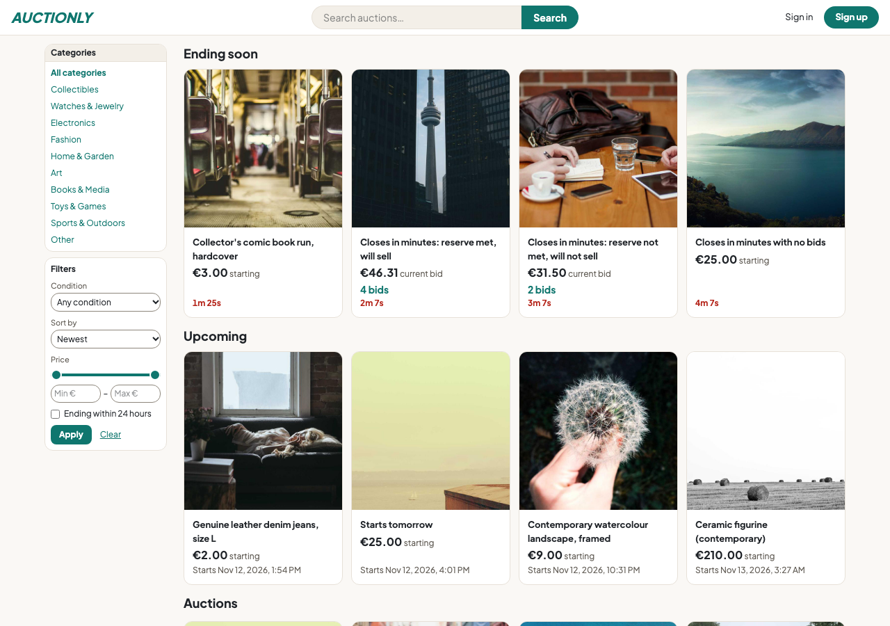
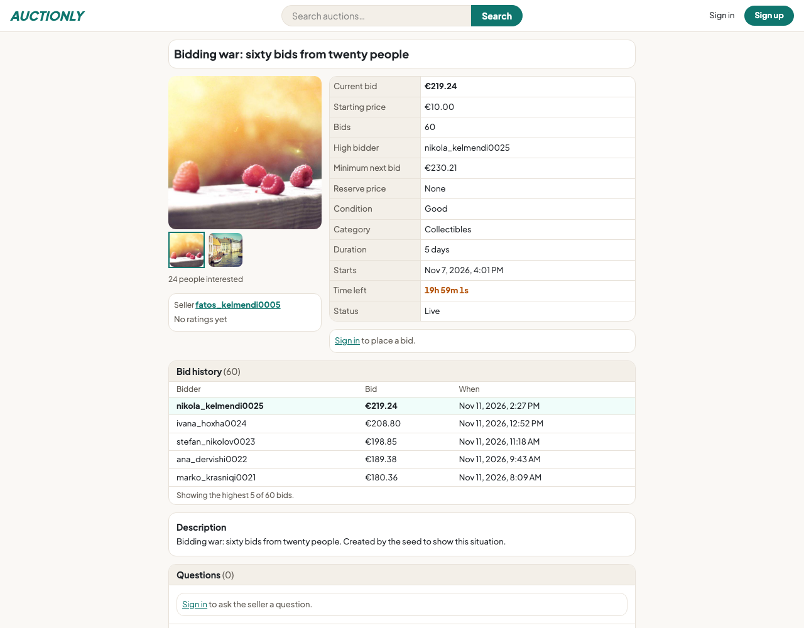
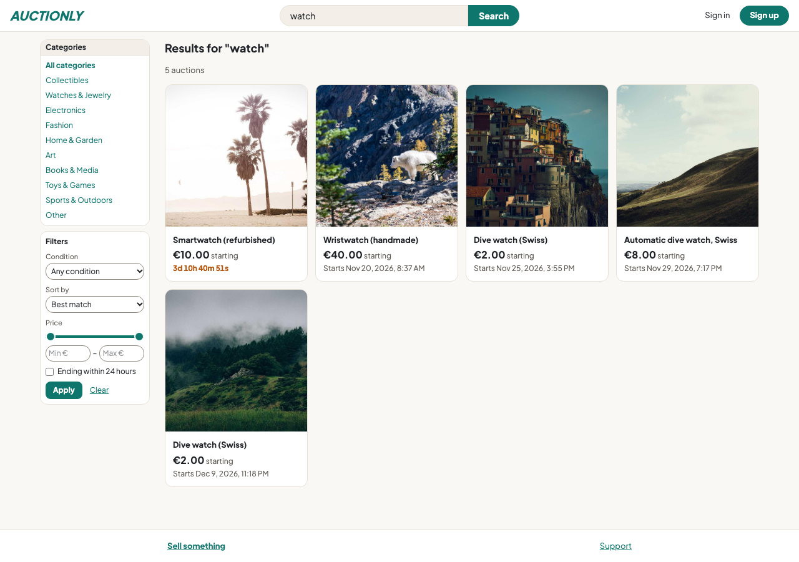
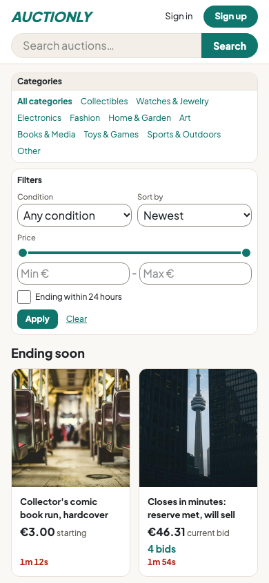
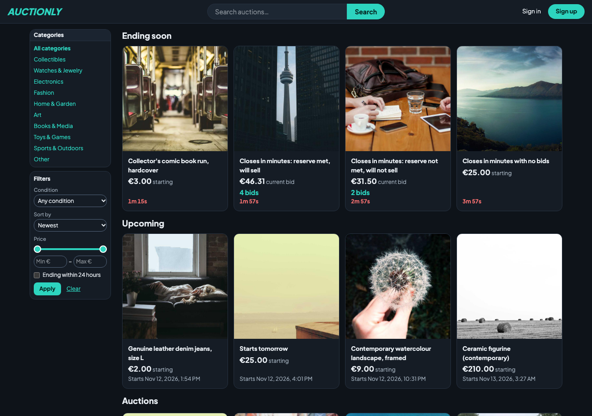
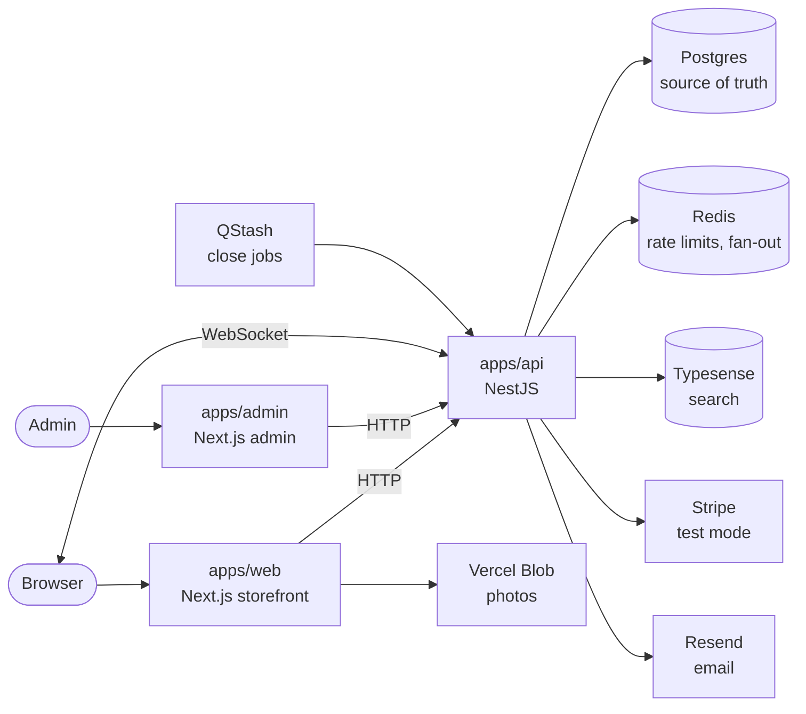

# Auction App

A multi-seller timed-auction marketplace: anyone can list an item, bid, win, pay by card and rate the seller. Built as a portfolio project to production-quality standards, on free tiers, with Stripe in test mode.

Turborepo monorepo: Next.js storefront and admin app, NestJS API, Prisma and Postgres, Redis, Typesense.



| Listing with a 60-bid war | Search | Phone, dark mode |
|---|---|---|
|  |  |   |

The photos are random placeholders from the seed script, so they don't match the item titles.

## Live demo

- Storefront: https://auction-web-taupe.vercel.app
- Admin app: https://auction-app-five-woad.vercel.app (admin accounts only, no public sign-up)

Stripe is in test mode: pay with card `4242 4242 4242 4242`, any future expiry and any CVC. The API runs on a free Fly.io machine that sleeps when idle, so the first request after a pause can take about 5 seconds.

## What it does

- **Auctions that behave like real ones.** Timed English auctions of 1 to 30 days with an optional reserve. The minimum next bid is `current + max(€1, 5%)`. A bid in the last 2 minutes extends the end by 2 minutes, up to a ceiling of 24 hours past the original end. Sellers cannot bid on their own items, and the high bidder cannot outbid themselves.
- **Live.** Bids, countdown jumps, extensions and outbid notices reach every open page over WebSocket. Outbid bidders also get an email with a one-click bid.
- **Close, pay, ship, pay out.** An idempotent close job picks the winner, who has 48 hours to enter a delivery address and pay by card. If they don't, they get a strike and the item is offered to the next bidder. The seller marks the item shipped, a fake carrier moves it to delivered, and the payout is released 3 days later. Platform fee: 5% of the item price, capped at €50.
- **Search.** Typesense with typo tolerance, synonyms, filters (category, condition, price, ending within 24 hours) and several sorts. Without Typesense the API falls back to a Postgres search that is tested to return the same results.
- **Trust and safety.** Rate limits on sign-in, sign-up, bids, search and uploads; strikes and bans; public Q&A on listings with reports; sessions that die when the password changes; descriptions and photos locked once the first bid is placed.
- **Admin app.** Separate Next.js app and theme, no public sign-up. Reports queue, question log, listing removal, bans, strikes and appeals, an audit log of every admin action, and an order view with a "needs attention" filter, private notes, email resend and invoices.

## Architecture



- The Next.js apps never touch the database; everything goes through the API.
- **Postgres decides every bid.** One transaction locks the listing row, checks the minimum, saves the bid and moves the end time together, so there is no second source of truth to repair after a crash. Redis only carries rate limits and WebSocket fan-out.
- Payment, shipping, search and mail sit behind interfaces (`PaymentProvider`, `ShippingProvider`, `SearchIndex`, `MailSender`), each with a real and a fake implementation, so tests run without any outside service.
- Rules shared by web and API (bid minimum, anti-sniping, fees, limits) live in `packages/shared`, so the two cannot disagree.

Every decision, with its reason and date, is in [docs/DESIGN.md](docs/DESIGN.md) and [docs/decisions/](docs/decisions/). Visual rules are in [docs/DESIGN-SYSTEM.md](docs/DESIGN-SYSTEM.md).

## Testing

- **600+ API tests** (Vitest) against real Postgres and Redis, including a concurrency test: 50 simultaneous bids on one auction, exactly one wins. Plus web tests and Playwright end-to-end specs for sign-up, bidding, winning and paying, admin moderation and support (`apps/e2e`, run on demand).
- A parity test requires the Postgres search and Typesense to return the same results.
- GitHub Actions runs lint, typecheck and the tests on every pull request.

Not covered: the admin app has no tests of its own (its behaviour is covered through the API tests and the Playwright admin spec), and there has been no load test yet.

## Scope

Left out on purpose:

- Real money and fulfilment: Stripe runs in test mode, and shipping and payouts use fake providers behind interfaces.
- Legal and compliance: terms, privacy policy and tax/VAT.
- Operations: monitoring, alerting and backup drills. It runs on free tiers.
- Refunds and disputes after payment, proxy bidding, buy-it-now, offers and private messages. See `docs/DESIGN.md` for why.

The hosted API runs on Fly.io's free trial, which stops the machine five minutes after each start. The first request after a pause takes a few seconds, and live sockets reconnect. The design accounts for this (idempotency keys on bids, state re-checked after failures); see `docs/decisions/tooling-hosting.md`.

## Requirements

- Node 24 and Docker Desktop
- Yarn 4 via Corepack: `corepack enable` (if that needs root, use `corepack enable --install-directory ~/.local/bin`)

## Setup

```sh
yarn install
cp .env.example .env          # then set AUTH_SECRET to a random string of 32+ characters
yarn db:up                    # Postgres and Redis
yarn workspace @auction/db migrate:dev
yarn build                    # builds the shared packages the apps import; rerun after changing packages/shared or packages/db
```

## Run

```sh
yarn workspace @auction/api dev     # http://localhost:4000
yarn workspace @auction/web dev     # http://localhost:3000
yarn workspace @auction/admin dev   # http://localhost:3001
```

In development the API prints emails (the 6-digit sign-in codes) to its log instead of sending them. Set `RESEND_API_KEY` (and optionally `MAIL_FROM`) to send real email through Resend. In production the API refuses to start without `RESEND_API_KEY`.

To fill a local database with sample accounts and auctions in every state (extended, closing in minutes, a 60-bid war, paid, shipped, unpaid with a strike), run `yarn workspace @auction/db seed`. The options are in `docs/DESIGN.md` section 6. It refuses to touch a remote database unless told twice.

## Photos (Vercel Blob)

Photo uploads use Vercel Blob with OIDC, so there is no secret to copy. Once, with a Vercel account that owns the Blob store:

```sh
npx vercel link                              # choose the auction-web project
npx vercel env pull apps/web/.env.local      # BLOB_STORE_ID, BLOB_WEBHOOK_PUBLIC_KEY, VERCEL_OIDC_TOKEN
```

The OIDC token lasts 12 hours; the SDK refreshes it using your Vercel CLI login, or run the pull again. Restart the web server after pulling. In production, set `BLOB_PUBLIC_HOST` on the API so it accepts photo URLs from that host only.

## Checks

```sh
yarn lint
yarn typecheck
yarn test    # API tests need Postgres running (yarn db:up)
yarn test:local    # API tests on their own empty database (auction_test), away from dev data and the dev API
yarn build
```

## Layout

- `apps/web`: storefront (Next.js)
- `apps/admin`: admin app (Next.js)
- `apps/api`: NestJS API
- `apps/e2e`: Playwright end-to-end tests
- `packages/db`: Prisma schema and client
- `packages/shared`: types, Zod schemas, shared rules
- `packages/ui`: shared UI primitives
- `packages/config`: shared tsconfig and eslint
